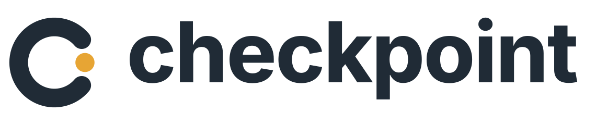

<picture>
  <source media="(prefers-color-scheme: dark)" srcset="public/brand/lockup-dark.svg">
  
</picture>

**Agent work. Engineering judgment.**

Checkpoint is a self-hosted review workspace for engineering teams and coding agents. Bring design specs, architecture proposals, and implementation plans into a shared conversation. Review the tradeoffs, give precise feedback, and record a decision on the exact version an agent should work from.

[](https://github.com/rdpr/checkpoint/actions/workflows/verify.yml)
[](https://github.com/rdpr/checkpoint/releases)
[](LICENSE)

<picture>
  <source media="(prefers-color-scheme: dark)" srcset="docs/images/checkpoint-dark.png">
  
</picture>

## What you can do

- **Steer agent work through review.** Agents publish specs through MCP, request a human review, and read the feedback to revise. Resolve architectural questions before committing to an implementation.
- **Discuss the design where it matters.** Comment on a passage or diagram element, suggest a deletion, and resolve threads. Keep constraints and tradeoffs next to the proposal they concern.
- **Know exactly what was reviewed.** Approvals and requested changes belong to a saved revision. Compare revisions to see how feedback was addressed; new edits never inherit an old approval.
- **Keep the decision and its context.** Preserve discussion and revision history, restore earlier content, or export feedback for an agent’s next task.
- **Coordinate review across projects.** Organize artifacts in folders, search across your workspaces, and follow assigned requests in My reviews. In-app notifications surface replies and review outcomes.
- **Control access on your infrastructure.** Scope agent credentials to a workspace, manage team membership and service accounts, and use optional Microsoft Entra sign-in. Organization administration and access changes have an audit trail.

Review **Markdown**, **HTML previews**, **Mermaid and Graphviz diagrams** using Plannotator’s existing viewers and annotation tools. Create an artifact by choosing its format or importing a UTF-8 file. Markdown includes code, math, and images; HTML supports text selections and element pinpoints, including multiple targets in one discussion. Use Markup to open the selection toolbar, or Comment to open a discussion directly. HTML supports comments and Looks good; redlines and other quick labels are available in the Markdown viewer. Switch to Interact to try a preview’s controls.

Markdown (`.md`, `.mdx`), HTML (`.html`, `.htm`), Mermaid (`.mmd`, `.mermaid`), and Graphviz (`.dot`, `.gv`) have rendered previews. MDX uses Markdown rendering; JSX is not executed. Other accepted text files are displayed as source code, without a specialized preview.

HTML runs in an isolated iframe, including its scripts, without access to the app’s session or page. Use self-contained HTML with inline or embedded assets; importing a file does not upload its asset directory. External assets require network access. All formats retain original source, revision-bound reviews, discussion, search, and MCP access. Non-Markdown formats have a source editor and source comparisons; comment on the rendered revision. Renames preserve the rendering format.

## Install

Checkpoint ships as a container image and a Helm chart. Docker Compose is the simplest installation; Kubernetes is supported for organizations that already operate a cluster.

| Deployment | Requirements | Guide |
| --- | --- | --- |
| Docker Compose | Linux/amd64, Docker Engine with Compose, local storage, HTTPS reverse proxy | [Install with Compose](docs/installation.md#docker-compose) |
| Kubernetes | Linux/amd64 nodes, Helm 3, single-writer block storage, HTTPS ingress | [Install with Helm](docs/installation.md#kubernetes) |

Get the deployment bundle or chart from [Releases](https://github.com/rdpr/checkpoint/releases). The image is `ghcr.io/rdpr/checkpoint`; select an explicit version or the digest recorded in that release's `release.json`. Published images support **linux/amd64**. There is no floating `latest` tag and no automatic production updater.

Each installation has one organization and one application writer backed by SQLite. Images, discussions, reviews and account records are included in database backups. Kubernetes does not turn this into a multi-replica application. Use local or single-writer block storage, and allow brief downtime for upgrades.

See [installation and identity](docs/installation.md) for bootstrap, Entra and deployment configuration. See [operations](docs/operations.md) for backup, restore, monitoring and upgrades.

Upgrading from 0.1.0? Version 0.2.0 adds persistent folders and migrates the database. Read the [release notes](CHANGELOG.md#020--2026-10-12) and [upgrade guide](docs/operations.md#upgrading-from-010-to-020) before changing versions.

## A typical review

The [webhook delivery example](docs/examples/webhook-delivery.md) illustrates this workflow:

1. Ask an agent to draft a webhook delivery design with a system diagram, failure cases, and open decisions. It publishes `specs/webhook-delivery.md` through MCP.
2. Request a review from the engineer responsible for the service.
3. Discuss retry safety on the relevant passage or diagram, then approve or request changes on that revision.
4. Have the agent read the feedback and revise. Compare the versions and review the changes.
5. Use the reviewed spec and its decision record to guide implementation.

Approvals express a review decision; they do not lock editing or enforce an implementation gate. A review request is completed by a fresh response from its assigned reviewer on its exact revision.

## Connect an agent

Open **your name → Agent access**, create a personal key or workspace service account, and copy the connection configuration for your client. The MCP endpoint is:

```text
https://your-checkpoint.example.com/mcp
```

Keys are limited to one workspace and read or write access. Personal keys follow their owner's membership; service-account keys belong to the workspace. The connection check verifies identity and capabilities without changing artifacts. See the [agent guide](docs/mcp.md) for the workflow and security boundaries.

## Designed for explicit review

Checkpoint uses explicit saves and periodic refresh. Concurrent saves preserve the stale draft for reconciliation. It does not provide simultaneous typing, Git synchronization, or public artifact links. Notifications are in-app; email and chat delivery are not included.

Drafts are stored in the current browser and do not sync across devices or enter server backups. Relative Markdown and HTML artifact links stay associated with their original destinations after moves; old paths remain reserved. Access remains workspace-based, including when a link is shared elsewhere.

## Install the web app

Open your installation over HTTPS. Supporting browsers offer **Install Checkpoint**; you can also find installation guidance under **your name → Account & appearance**. The app opens in its own window with the Checkpoint icon. It still needs a connection to your server. See [browser installation](docs/installation.md#install-in-your-browser) for platform details.

## Develop and contribute

Use Node.js **22.22.1**, npm, and Python 3 on Linux for the full integration suite:

```sh
npm ci
npm run dev
```

The development UI runs at `http://localhost:5173`. Create the first account there. Development data defaults to `.data`; use a separate directory and port if a production instance is running on the same host.

[Contributing](CONTRIBUTING.md) covers development, meaningful test coverage and dependency updates. [Release engineering](docs/releases.md) explains versioning, checks and artifact publication. Report vulnerabilities through the process in [SECURITY.md](SECURITY.md).

## Built with Plannotator

Checkpoint uses the pinned open-source Plannotator viewer, editor and diff components. It is an independent project, not affiliated with the commercial Plannotator Workspaces offering. Artifact Server is not required.

Server-side diff comment validation runs in isolated workers with a 1.5-second deadline and at most two concurrent comparisons. Comparisons that exceed the budget can still receive ordinary artifact discussions; rejected diff comments save no comment or submission receipt. Reverse-proxy deployments must configure explicit trusted proxy addresses so authentication limits apply to individual clients; see [installation](docs/installation.md).

Checkpoint is licensed under [Apache-2.0](LICENSE). See [third-party notices](THIRD_PARTY_NOTICES.md); distributed browser builds include `/THIRD_PARTY_LICENSES.txt` with dependency license texts.

Logo SVGs, transparent PNGs, and app icons are in [`public/brand`](public/brand). See the [asset guide](docs/branding.md) for light and dark variants.
