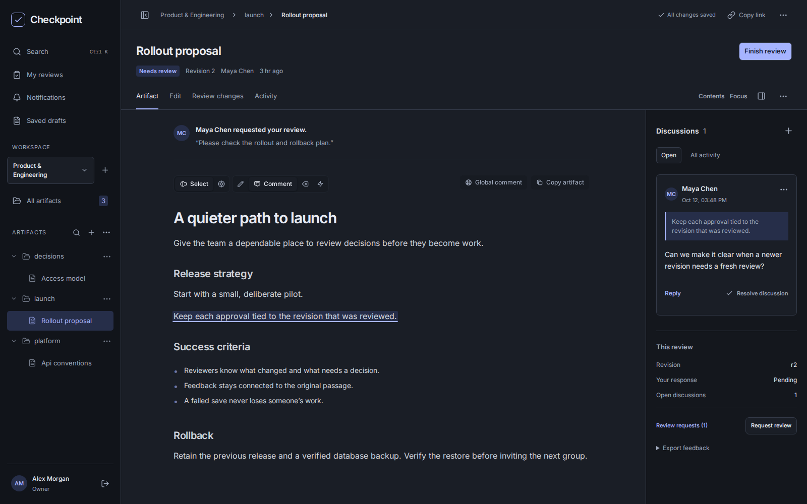

# Checkpoint

**A shared place to review plans before they become work.**

Checkpoint is a self-hosted Markdown workspace for teams and coding agents. Write a proposal, leave feedback on specific passages, compare revisions, and record a human decision against the exact version reviewed.

[](https://github.com/rdpr/checkpoint/actions/workflows/verify.yml)
[](https://github.com/rdpr/checkpoint/releases)
[](LICENSE)



## What you can do

- **Choose your reading environment.** Light, dark, or system appearance; independent reading width and discussions; a focused mobile review drawer. Personal review settings stay in your browser.
- **Review precisely.** Select text or pinpoint an element to comment, suggest a deletion, or apply a custom label. Attach images, reply, and resolve discussions.
- **Keep decisions tied to evidence.** Approvals, requested changes, and review requests belong to a saved revision. New edits never inherit an old approval.
- **Understand what changed.** Compare revisions using rendered or source diffs, retain discussion provenance, and restore earlier content as a new revision.
- **Work together safely.** Explicit saves detect conflicts. Browser-local drafts survive closing tabs and expired sessions, with recovery controls for failed saves.
- **Organize shared knowledge.** Browse persistent folders, search artifacts, rename or move them without breaking existing links, archive completed work, and follow requests across workspaces in My reviews.
- **Bring agents into the same workflow.** A scoped MCP endpoint lets agents publish artifacts, request reviews, read feedback, and revise. Only people can approve.
- **Administer one organization.** Manage teams, workspace roles, ownership transfers, offboarding, service accounts, and an administrative audit log. Microsoft Entra ID sign-in is optional.

## Install

Checkpoint ships as a container image and a Helm chart. Docker Compose is the simplest installation; Kubernetes is supported for organizations that already operate a cluster.

| Deployment | Requirements | Guide |
| --- | --- | --- |
| Docker Compose | Linux/amd64, Docker Engine with Compose, local storage, HTTPS reverse proxy | [Install with Compose](docs/installation.md#docker-compose) |
| Kubernetes | Linux/amd64 nodes, Helm 3, single-writer block storage, HTTPS ingress | [Install with Helm](docs/installation.md#kubernetes) |

Get the deployment bundle or chart from [Releases](https://github.com/rdpr/checkpoint/releases). The image is `ghcr.io/rdpr/checkpoint`; select an explicit version or the digest recorded in that release's `release.json`. Published images support **linux/amd64**. There is no floating `latest` tag and no automatic production updater.

Each installation has one organization and one application writer backed by SQLite. Images, discussions, reviews and account records are included in database backups. Kubernetes does not turn this into a multi-replica application. Use local or single-writer block storage, and allow brief downtime for upgrades.

See [installation and identity](docs/installation.md) for bootstrap, Entra and deployment configuration. See [operations](docs/operations.md) for backup, restore, monitoring and upgrades.

Upgrading from 0.1.0? Version 0.2.0 adds persistent folders and migrates the database. Read the [release notes](CHANGELOG.md#020--2026-10-12) and [upgrade guide](docs/operations.md#upgrading-from-010-to-020) before changing versions.

## A typical review

1. Create a workspace and invite the people who need access.
2. Write or publish a Markdown artifact.
3. Request a review of the saved revision. The reviewer can annotate passages and approve or request changes.
4. Revise the artifact, compare it with the reviewed version, and request another review.
5. Keep the record here or export the revision's feedback as Markdown.

Approvals express a review decision; they do not lock editing or enforce an implementation gate. A review request is completed by a fresh response from its assigned reviewer on its exact revision.

## Connect an agent

Open **your name → Agent access**, create a personal key or workspace service account, and copy the connection configuration for your client. The MCP endpoint is:

```text
https://your-checkpoint.example.com/mcp
```

Keys are limited to one workspace and read or write access. Personal keys follow their owner's membership; service-account keys belong to the workspace. The connection check verifies identity and capabilities without changing artifacts. See the [agent guide](docs/mcp.md) for the workflow and security boundaries.

## Designed for explicit review

Checkpoint uses explicit saves and periodic refresh. It does not provide simultaneous typing, Git synchronization, public artifact links, or HTML artifact hosting. In-app notifications cover review requests, replies and review outcomes; email and chat delivery are not included.

Drafts are stored in the current browser and do not sync across devices or enter server backups. Relative Markdown links stay associated with their original destinations after moves; old paths remain reserved. Access remains workspace-based, including when a link is shared elsewhere.

## Develop and contribute

Use Node.js **22.22.1**, npm, and Python 3 on Linux for the full integration suite:

```sh
npm ci
npm run dev
```

The development UI runs at `http://localhost:5173`. Create the first account there. Development data defaults to `.data`; use a separate directory and port if a production instance is running on the same host.

[Contributing](CONTRIBUTING.md) covers development, meaningful test coverage and dependency updates. [Release engineering](docs/releases.md) explains versioning, checks and artifact publication. Report vulnerabilities through the process in [SECURITY.md](SECURITY.md).

## Built with Plannotator

Checkpoint uses the pinned open-source Plannotator viewer, editor and diff components. It is an independent project, not affiliated with the commercial Plannotator Workspaces offering. Artifact Server is not required.

Checkpoint is licensed under [Apache-2.0](LICENSE). See [third-party notices](THIRD_PARTY_NOTICES.md); distributed browser builds include `/THIRD_PARTY_LICENSES.txt` with dependency license texts.
