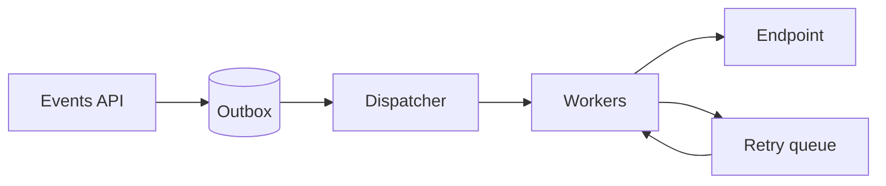

# Webhook delivery architecture

Deliver product events to customer endpoints without coupling API availability to downstream failures. This review covers delivery guarantees, retry safety, and tenant isolation.

## Proposed architecture

The API commits the event and outbox entry in one Postgres transaction. Workers deliver asynchronously; endpoint failures never roll back the originating request.

## Design decisions

| Concern | Proposed decision |
| --- | --- |
| Delivery guarantee | At-least-once delivery; preserve the delivery ID across retries. |
| Retry policy | Exponential backoff with jitter, capped at 24 hours. |
| Tenant isolation | Per-tenant concurrency limits and separate retry budgets. |

## Failure handling

A timeout is an unknown outcome, not proof that delivery failed. Receivers deduplicate using the stable delivery ID. A worker crash releases its lease; the next worker retries with the same ID and payload.

After the retry budget expires, move the delivery to a dead-letter queue. Alert on exhaustion and expose an explicit replay action with an audit record.

## Open decisions

- Should manual replay preserve the original delivery ID or create a linked attempt?
- What concurrency limit prevents one slow tenant from delaying others?
- How long should payloads remain available for debugging and replay?

## Implementation checks

- Kill a worker after delivery but before acknowledgment; verify receiver deduplication.
- Simulate prolonged endpoint failure and confirm backoff, exhaustion, and replay behavior.
- Load-test two tenants with different response times and verify isolation.
- Measure outbox age, delivery latency, retry volume, and dead-letter depth.
